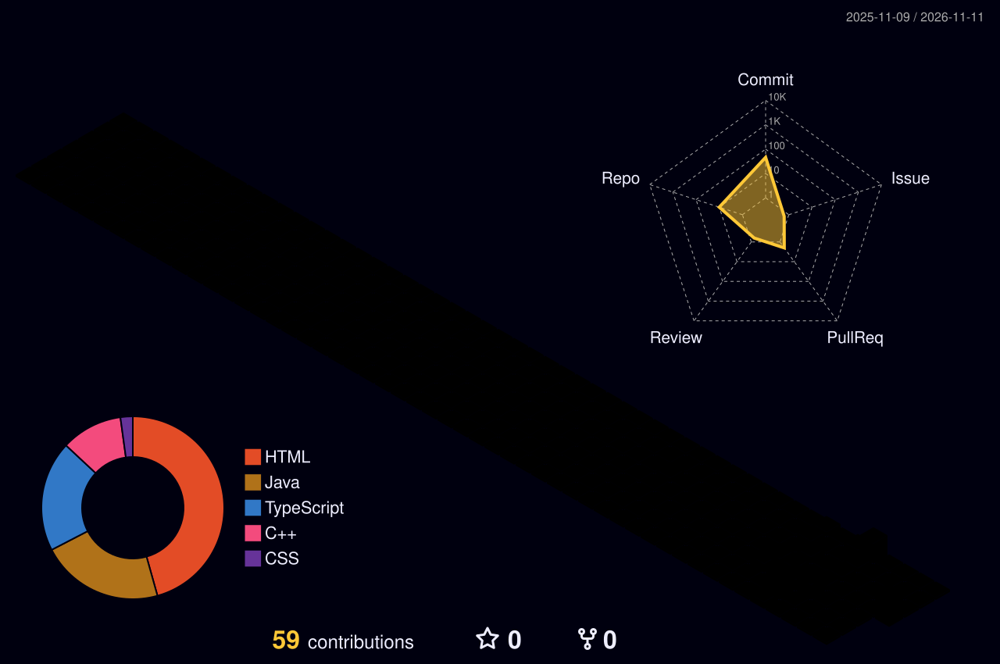

## 💫 About Me

👋 About Me

🎓 I'm a Computer Engineering student passionate about **Artificial Intelligence, Machine Learning, and building technology-driven solutions.**

💻 I work with **Python, C++, Java, JavaScript, TensorFlow, OpenCV, and Scikit-learn.**

🚀 I'm continuously strengthening my problem-solving and development skills through hands-on projects, continuous learning, and collaboration.

🌱 Always curious to explore emerging technologies, take on new challenges, and turn innovative ideas into impactful solutions!

---

## 🌐 Socials

---

## 💻 Tech Stack

#### 📘 Languages

#### 🌐 Web Development

#### 🤖 AI & Data

#### ☁️ Tools, Cloud & Hardware

---

## 📊 GitHub Stats

---

-->

<!-- Proudly created with GPRM ( https://gprm.itsvg.in ) -->
